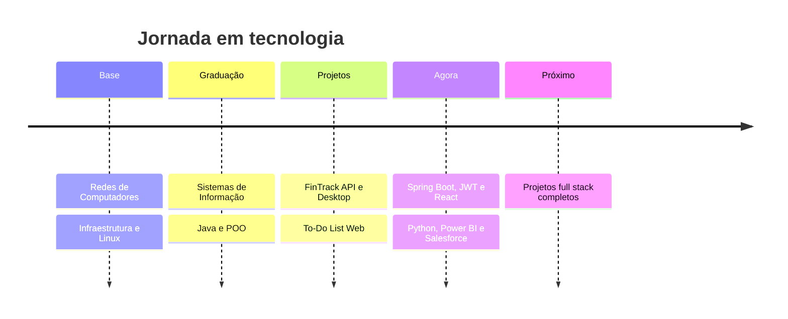

<!-- ======================= CABEÇALHO ANIMADO ======================= -->
<div align="center">


<a href="https://github.com/PaulaoGeek">
  
</a>

<br/><br/>

<a href="https://www.linkedin.com/in/antonio-paulo-melo-jr-9b1603263/"></a>
<a href="https://www.youtube.com/@PaulaoTIdev"></a>
<a href="https://www.instagram.com/paulaojrr/"></a>

<br/>


</div>

<br/>

<!-- ======================= SOBRE ======================= -->
## 🖥️ `whoami`

```bash
┌──(antonio㉿developer)-[~]
└─$ whoami
Antonio Paulo Melo Jr.

┌──(antonio㉿developer)-[~]
└─$ cat perfil.json
{
  "formação": ["Bacharelado em Sistemas de Informação", "Técnico em Redes de Computadores"],
  "cidade": "Ibiapina",
  "foco": "Desenvolvimento de software com Java e JavaScript",
  "estudandoAgora": ["Spring Boot", "APIs REST", "React", "Python", "Power BI", "Salesforce"],
  "objetivo": "Construir soluções completas e crescer na área de desenvolvimento 🚀"
}
```

Sou formado em **Sistemas de Informação** e **Técnico em Redes de Computadores**. Gosto de desenvolvimento de software, principalmente **back-end com Java**, mas também construo interfaces com **JavaScript e React**, e levo comigo a base de **infraestrutura e redes** na hora de pensar em sistemas.

<br/>

<!-- ======================= STACK ======================= -->
## ⚡ Tech Stack

<div align="center">


<br/>

<br/><br/>


</div>

<br/>

<!-- ======================= PROJETOS ======================= -->
## 🚀 Projetos em destaque

<div align="center">
<table>
  <tr>
    <td align="center" width="50%">
      <a href="https://github.com/PaulaoGeek/fintrack-api">
        
      </a>
      <br/>
      <sub><b>API REST de finanças pessoais</b><br/>Java 21 • Spring Boot • MySQL • JWT</sub>
    </td>
    <td align="center" width="50%">
      <a href="https://github.com/PaulaoGeek/New-Fx-Fintrack-">
        
      </a>
      <br/>
      <sub><b>App desktop de controle financeiro</b><br/>Java • JavaFX • SQLite</sub>
    </td>
  </tr>
  <tr>
    <td align="center" width="50%">
      <a href="https://github.com/PaulaoGeek/Mini-Projeto-Livraria-emprestimos-de-Livro">
        
      </a>
      <br/>
      <sub><b>Empréstimo de livros com POO</b><br/>Java • Encapsulamento, Herança e Polimorfismo</sub>
    </td>
    <td align="center" width="50%">
      <a href="https://github.com/PaulaoGeek/Criar-e-Excluir-tarefas">
        
      </a>
      <br/>
      <sub><b>To-Do List para organizar tarefas</b><br/>JavaScript • HTML • CSS</sub>
    </td>
  </tr>
</table>
</div>

<details>
<summary><b>📂 Ver todos os repositórios</b></summary>
<br/>

👉 [github.com/PaulaoGeek?tab=repositories](https://github.com/PaulaoGeek?tab=repositories)

</details>

<br/>

<!-- ======================= ESTATÍSTICAS ======================= -->
## 📊 GitHub Analytics

<div align="center">


<br/>


</div>

<br/>

## 📈 Gráfico de contribuições

<div align="center">


<br/>


</div>

<br/>

<!-- ======================= TROFÉUS ======================= -->
## 🏆 Troféus

<div align="center">


</div>

<br/>

<!-- ======================= ROADMAP ======================= -->
## 🧭 Meu caminho



<br/>

<!-- ======================= CONTATO / RODAPÉ ======================= -->
## 📡 Vamos conversar?

Se curtiu algum projeto, quer trocar ideia sobre tecnologia ou tem uma oportunidade, é só chamar!

<div align="center">

<a href="https://www.linkedin.com/in/antonio-paulo-melo-jr-9b1603263/"></a>
<a href="https://www.youtube.com/@PaulaoTIdev"></a>

<br/><br/>

### 🔴 `while (alive) { keepLearning(); keepCoding(); }`

*"O conhecimento é construído linha por linha."*


</div>
